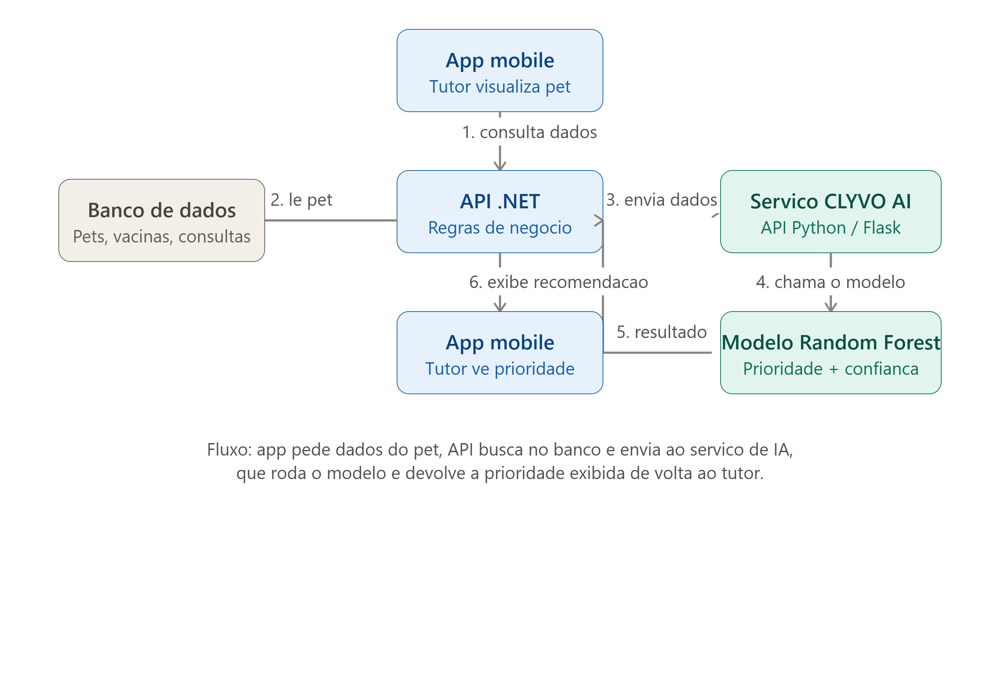

# CLYVO AI — Assistente Inteligente de Saúde Pet

Componente de Inteligência Artificial do projeto **PetCareAI+**, solução do grupo para o desafio da **CLYVO VET** (FIAP Challenge 2026),
responsável por analisar dados do pet e gerar uma **priorização de cuidados**
(baixa / média / alta), apoiando o tutor a agir preventivamente antes de um
problema de saúde se agravar.

## Integrantes do Grupo

* **Bruno Vinicius Barbosa** – RM 566366
* **Guilherme de Andrade Martini** – RM 566087
* **Nathan Gonçalves Pereira Mendes** – RM 564666
* **Raphael Gomes Mancera** – RM 562279

## Problema de negócio

Tutores frequentemente perdem o timing de vacinas, consultas de rotina e
cuidados preventivos por falta de acompanhamento ativo. O CLYVO AI resolve
isso analisando o histórico e os sintomas do pet e sinalizando quando ele
precisa de atenção prioritária.

## Abordagem escolhida

**Modelo preditivo (classificação supervisionada)** usando Random Forest,
treinado sobre um dataset clínico veterinário real
([Veterinary Clinical Dataset](https://www.kaggle.com/datasets/lolhaterbro/veteriary-clinical-dataset),
Kaggle, 10.000 registros, licença MIT).

O dataset original não traz uma coluna pronta de diagnóstico/risco — apenas
`AnimalName` (na prática, a espécie), `Breed`, `Age`, `Weight_kg`,
`MedicalHistory` e `Symptom_1..Symptom_5` (texto livre, ~900 valores únicos
distintos, com bastante variação de digitação/sinônimos). Por isso o
rótulo de prioridade (`risk_priority`: low/medium/high) é **derivado**:

1. Cada sintoma recebe um **score de gravidade** (1 a 3) por correspondência
   com palavras-chave associadas a quadros críticos (`death`, `seizure`,
   `difficulty in breathing` etc.) ou moderados (`fever`, `pain`, `weakness`
   etc.), definidas com base em conhecimento de domínio.
2. Cada categoria de `MedicalHistory` recebe um peso de risco (0 a 3),
   por exemplo `chronic illness` pesa mais que `no previous conditions`.
3. Idade ≥ 8 anos soma +1 ao score (indicador de pet sênior).
4. O score final é dividido em tercis (`low`/`medium`/`high`), garantindo
   uma distribuição balanceada independente da distribuição bruta dos dados.

O modelo é então treinado com Random Forest para **generalizar** esse
padrão — inclusive para combinações de sintomas, raça e idade que não
apareceram exatamente iguais no dataset de treino.

## Dados utilizados

| Campo | Origem | Uso |
|---|---|---|
| AnimalName (espécie), Breed, Age, Weight_kg | Cadastro do pet (banco PetCareAI+) | Perfil demográfico |
| MedicalHistory | Prontuário do pet | Sinal de condição pré-existente |
| Symptom_1..Symptom_5 | Relato do tutor / consulta | Sinais clínicos atuais |
| risk_priority (target) | **Derivado** a partir das colunas acima (ver `engineer_target()` em `train_model.py`) | O que o modelo aprende a prever |

## Arquitetura de integração (implementada na Sprint 4)



```
App / Swagger (tutor)
      |  POST /api/pets/{id}/avaliacao-risco  (histórico médico + sintomas em português)
      v
API PetCareAI (.NET) ------> Azure SQL (espécie, raça, idade e peso do pet)
      |
      |  traduz os dados para o formato do modelo e chama POST /predict
      v
Serviço CLYVO AI (este repositório, Python / Flask)
      |
      v
Modelo treinado (Random Forest) -> prioridade + probabilidades
      |
      v
API devolve prioridade (Alta/Média/Baixa) + recomendação ao tutor
e registra a avaliação no histórico de atividades (MongoDB)
```

A API .NET está no repositório [PetCareAI-Sprint4](https://github.com/brunovb002/PetCareAI-Sprint4).

## Estrutura do projeto

```
petcareai-clyvo-ai/
├── data/
│   └── veterinary_clinical_dataset.csv   # dataset real (Kaggle)
├── model/
│   ├── clyvo_ai_model.joblib             # modelo treinado
│   └── clyvo_ai_encoder.joblib           # encoder das colunas categóricas
├── train_model.py                        # treina e salva o modelo
├── predict.py                            # carrega o modelo e faz predições
├── app.py                                # API REST (Flask) - Sprint 4
├── test_app.py                           # testes da API - Sprint 4
├── requirements.txt
├── clyvo_ai_arquitetura.png              # diagrama arquitetural
└── README.md
```

## Como usar

```bash
pip install -r requirements.txt

# 1. (Opcional) Treine o modelo de novo, o dataset já está em data/:
python train_model.py

# 2. Rode uma predição de exemplo no terminal:
python predict.py

# 3. Suba a API REST (http://localhost:5000):
python app.py

# 4. Rode os testes da API:
python -m unittest -v
```

## Resultados parciais (Sprint 3)

Modelo treinado com o dataset real (10.000 registros): **90% de acurácia**
geral na classificação de prioridade (low/medium/high).

| Classe | Precision | Recall | F1 |
|---|---|---|---|
| high | 0.95 | 0.71 | 0.81 |
| medium | 0.83 | 0.96 | 0.89 |
| low | 0.97 | 0.92 | 0.94 |

O recall menor na classe "high" é esperado — é a menor classe (1.946 de
10.000 registros) e a mais heterogênea, já que reúne casos que combinam
diferentes fatores de risco. Em produção (Sprint 4), esse é o ponto a
monitorar de perto, já que falsos negativos em "high" são o cenário mais
custoso (deixar de sinalizar um caso realmente urgente).

Testes qualitativos confirmam o comportamento esperado do modelo:
- Cão idoso, doença crônica, sintomas graves (dificuldade respiratória,
  fraqueza, febre) → **high priority (78.8% de confiança)**
- Gato jovem, saudável, sem histórico, sintomas leves → **low priority
  (99.7% de confiança)**

## Sprint 4: modelo retreinado

O próximo passo listado na Sprint 3 era melhorar o recall da classe "high". O modelo foi retreinado com
`class_weight="balanced"` no Random Forest, que dá mais peso à classe menor durante o treino
(mesmo dataset, mesmo split e mesmos hiperparâmetros):

| Métrica (conjunto de teste, 2.000 registros) | Sprint 3 | Sprint 4 |
|---|---|---|
| Recall "high" (casos urgentes detectados) | 0.71 | **0.99** |
| Precision "high" | 0.95 | 0.93 |
| F1 "high" | 0.81 | **0.96** |
| Acurácia geral | 0.90 | **0.95** |

Em triagem de saúde, deixar de sinalizar um caso urgente (falso negativo) é o erro mais caro, então
trocar 2 pontos de precisão por 28 pontos de recall vale a pena. Um teste com árvores mais profundas
chegou a 0.99 de acurácia, mas foi descartado: como o rótulo é derivado por regras, isso indicaria
o modelo decorando a regra, não generalizando.

## Sprint 4: API REST e integração

### Endpoints (`app.py`)

| Método | Rota | Descrição |
|---|---|---|
| GET | `/health` | Retorna `{"status": "Healthy"}` |
| POST | `/predict` | Recebe os dados do pet e devolve a prioridade |

O modelo é carregado do disco **uma única vez** e reaproveitado em todas as requisições.

**Exemplo:**

```bash
curl -X POST http://localhost:5000/predict -H "Content-Type: application/json" -d '{
  "AnimalName": "Dog", "Breed": "Labrador Retriever", "Age": 11, "Weight_kg": 28.5,
  "MedicalHistory": "Chronic illness",
  "Symptom_1": "Difficulty in breathing", "Symptom_2": "Weakness", "Symptom_3": "Fever"
}'
```

```json
{ "priority": "high", "confidence": { "high": 0.88, "low": 0.0, "medium": 0.12 } }
```

- Campos obrigatórios: `AnimalName` (`Dog` ou `cat`), `Breed`, `Age`, `Weight_kg`, `MedicalHistory` e pelo menos um sintoma (`Symptom_1` a `Symptom_5`). Faltando algum, a resposta é **400** com a mensagem do erro.
- Raças que o modelo não conhece não quebram a predição (o encoder usa o valor "desconhecido").

### Testes (`test_app.py`)

7 testes com `unittest`, todos passando: health check, pet grave → `high`, pet saudável → `low`, probabilidades das 3 classes somando 1, raça desconhecida, campos obrigatórios ausentes (400) e requisição sem sintomas (400).

### Integração com a API .NET

A API PetCareAI expõe `POST /api/pets/{id}/avaliacao-risco`. O tutor envia o histórico médico e os sintomas **em português**; a API busca os dados do pet no banco, traduz tudo para o formato deste modelo (ex.: `Cachorro` → `Dog`, `SRD` → `Mixed Breed`, `febre` → `Fever`) e chama `/predict`. Com a resposta, a API:

- devolve a prioridade com uma **recomendação personalizada** e os **fatores** que pesaram (sinais graves e moderados, pet sênior, histórico de risco), usando a mesma escala de gravidade deste modelo;
- inclui um **alerta de segurança** quando há um sinal grave e a prioridade não é alta;
- **guarda cada avaliação** no banco, formando o histórico de saúde do pet (`GET /api/pets/{id}/avaliacoes`).

Resultados obtidos chamando este serviço pela API .NET (modelo retreinado):

| Pet | Sintomas relatados | Prioridade | Destaque da resposta |
|---|---|---|---|
| Cachorro Labrador, 11 anos, doença crônica | dificuldade para respirar, fraqueza, febre, letargia, dor | **high** (93%) | sinal grave, pet sênior, doença crônica |
| Gato Persa, 9 anos, doença renal prévia | perda de apetite, perda de peso, fraqueza | **medium** (57%) | histórico de doença renal |
| Cachorro SRD, 6 anos, não vacinado | vômito, diarreia | low (83%) | orienta a vacinação |
| Cachorro Poodle, 4 anos, vacinado | convulsão | low (77%) | **alerta de segurança** |
| Gato Siamês, 2 anos, sem condições prévias | espirros | **low** (100%) | sem fatores de risco |

**Limitações observadas:**
- O modelo usa sempre 5 colunas de sintoma. Quando o tutor informa menos, as vazias contam como sintoma leve, então relatos curtos (como o do Poodle) tendem a sair com prioridade menor do que um veterinário daria. O alerta de segurança da API cobre esse caso.
- O rótulo `risk_priority` é derivado por regras, não rotulado por veterinários; as métricas medem o quanto o modelo reproduz esse critério. A CLYVO AI é uma triagem de apoio e não substitui o veterinário.

### Deploy na Azure

O serviço roda em um Web App Python no mesmo App Service Plan da API. Um único comando cria o Web App e publica o código (o `requirements.txt` é instalado na publicação):

```bash
az webapp up --name clyvo-ai-566366 --resource-group rg-petcareai-devops --plan asp-petcareai-devops --runtime PYTHON:3.12
```

A URL do serviço (`https://clyvo-ai-566366.azurewebsites.net`) é configurada na API .NET pela variável `ClyvoAi__Url`.

## Próximos passos

- ✅ Expor `predict_priority()` como endpoint REST (Flask)
- ✅ Integrar o endpoint à API .NET do PetCareAI
- ✅ Testar com dados do banco do PetCareAI
- ✅ Melhorar o recall da classe "high" (`class_weight="balanced"`: 0.71 → 0.99)
- ✅ Recomendação personalizada e histórico de avaliações por pet (na API .NET)
- Considerar a quantidade de sintomas informados no treino
- Validar os rótulos de prioridade com veterinários da CLYVO VET
- Exibir a recomendação na tela do app mobile

## Tecnologias

Python, pandas, scikit-learn (RandomForestClassifier), joblib, Flask, gunicorn
